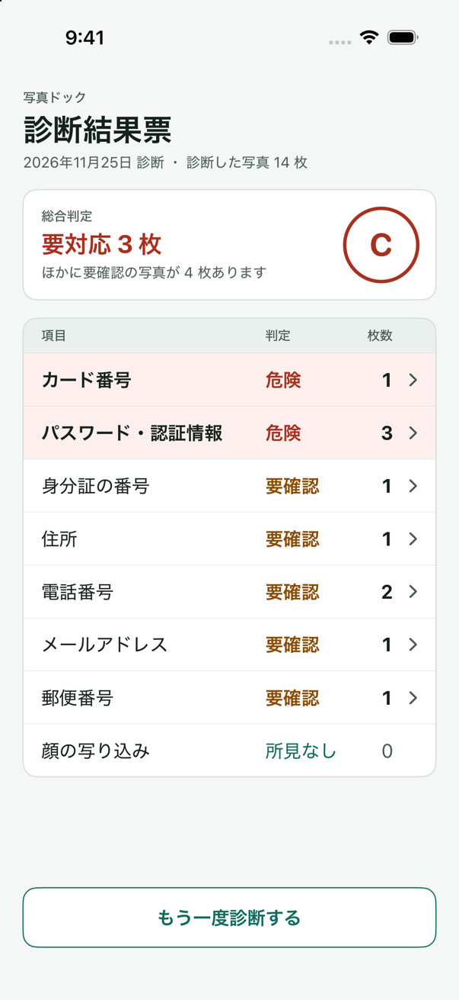
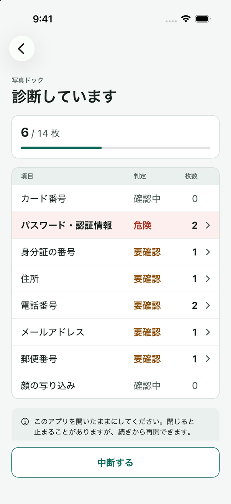
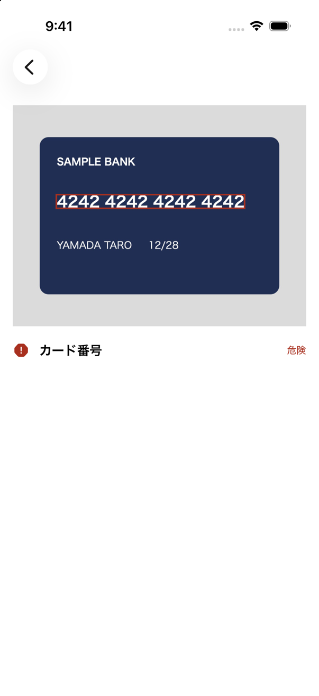
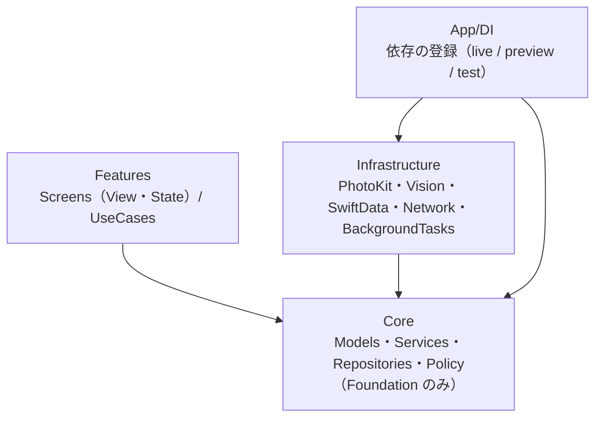

# 写真ドック（PhotoDock）

カメラロールにある「見られたらまずい写真」を洗い出す iOS アプリです。

カード番号・パスワード・住所などが写った写真を、ライブラリ全体のスキャンで見つけ、どの写真のどこに何が写っているかを示します。写真は端末の中だけで処理し、外部には送信しません。診断の結果は端末に記録され、2回目以降は新しい写真だけを診断します。

## 画面

<table>
  <tr>
    <th>診断結果票（ホーム）</th>
    <th>診断中</th>
    <th>写真詳細</th>
  </tr>
  <tr>
    <td></td>
    <td></td>
    <td></td>
  </tr>
</table>

スクリーンショットは、シミュレータにダミーの写真8枚（値はすべて架空）と標準のサンプル写真6枚を入れて診断したものです。14枚のうち7枚に所見が出て（危険3枚・要確認4枚）、注文番号の入ったレシートと風景写真6枚は所見なしになります。

結果は、検診の結果票のように項目ごとの判定で示します。総合判定は A（所見なし）・B（要確認あり）・C（危険あり）の3段階です。下の表にある「要注意」は、結果票の上では「要確認」と書きます。顔の写り込みは「参考」として枚数だけを出し、総合判定には数えません。

| 画面 | できること |
|------|-----------|
| はじめての案内 | 3つの約束（端末の中だけで診断する・写真は書き換えない・読み取った文字は残さない）を示してから、写真へのアクセスを確認する |
| 診断結果票（ホーム） | 前回までの診断を、総合判定と項目ごとの判定・枚数で表示する。開いただけでは診断しない。新しい写真があれば、その枚数だけを診断できる。iCloud にある写真も診断するかを選べる |
| 診断中 | 進捗と残り時間を出し、結果票の表を1枚ごとに埋めていく。所見のあった項目は診断中から開ける。中断でき、続きから再開できる |
| 項目の写真 | 結果票の行を押すと、その種類が写っている写真だけを一覧表示する |
| 写真詳細 | 写真の上に所見の位置を枠で示し、種類と危険度を一覧表示する |

## 検出できるもの

判定は正規表現・チェックサム・語彙で行います。生成モデルは使いません（数万枚を回す速度と、同じ写真に同じ結果を返す決定性のため）。

| 種類 | 判定の方法 | 危険度 |
|------|-----------|--------|
| カード番号 | Luhn チェックが通り、ブランドの番号帯と桁数に合う | 危険 |
| カード番号（ブランド不明） | Luhn チェックが通り、4桁×4で書かれている | 要注意 |
| 認証情報 | トークンの書式（`sk-`・`ghp_`・`AKIA`・JWT・秘密鍵など）、または「パスワード」などのラベル語の後ろに値が続く | 危険 |
| 認証情報（ラベル語だけ） | 「パスワードを忘れた方」のように、ラベル語はあるが値が続かない | 要注意 |
| 住所 | 市区町村の文字の後ろに番地が続く | 要注意 |
| 電話番号 | 携帯・IP 電話は11桁、固定電話・フリーダイヤルはハイフン区切りで合計10桁 | 要注意 |
| 郵便番号 | 3桁-4桁（長い数字の並びの一部は除く） | 要注意 |
| メールアドレス | 書式 | 要注意 |
| パスポート番号 | 英字2文字 + 数字7桁の書式 | 要注意 |
| 写り込みらしい顔 | 小さく、端にあるか横を向いている顔（実機のみ） | 要注意 |

検出した文字を表示するときはマスクします（`**** **** **** 4242`）。記録には種類・危険度・位置だけを保存し、本文は残しません。

## 構成

クリーン3層と、swift-dependencies による DI です。



| 層 | 役割 | 持てる依存 |
|----|------|-----------|
| `Core/Models` | ドメインの値型 | なし |
| `Core/Services`・`Core/Repositories` | 能力と永続化の protocol | なし |
| `Core/Policy` | 判断（入力 → 結論）の純粋関数 | なし |
| `Infrastructure/` | protocol の実装（PhotoKit・Vision・SwiftData など） | 実際の I/O |
| `Features/UseCases` | 段取り。具体的な struct | `@Dependency`（ここだけ） |
| `Features/Screens/<画面>` | State（`@Observable`）と View | State は UseCase のみ。View は依存を持たない |
| `App/DI` | 依存の登録 | Core と Infrastructure の両方を知る |

### 設計のポイント

- **厳格なのは「依存の向き」と「注入点」の2つだけ**：それ以外は、普通の MVVM に軽い UseCase 層を足した形です。生の依存（`@Dependency`）を持てるのは UseCase だけで、State は UseCase 経由でしか I/O に触れません。
- **判断は Policy、実行は UseCase**：「危険かどうか」「どう数えるか」は、I/O を持たない純粋関数として `Core/Policy` に置きます。フレームワークを起動せずに全パターンをテストできます。UseCase は順序だけを持ちます。
- **見ていないものを「問題なし」と言わない**：iCloud にあって端末に無い写真、見つからない写真、文字を読む処理が失敗した写真は、「診断できた・所見なし」とは別の結果として記録し、件数を画面に出します。次のスキャンで必ずやり直します。
- **依存の追加は3点セット**：Core の protocol → Infrastructure の実装 → `App/DI` への登録（live / preview / test の3値）。テスト用の値は、呼ばれたらクラッシュする実装にしてあります（上書きを忘れたときに、黙って本物を呼ばないため）。
- **規約は機械で検査する**：層の違反と注入点の違反は SwiftLint の custom rules で、DI の登録漏れはシェルスクリプトで検査し、CI でも同じものを回します。正規表現の文字一致なので、すり抜ける書き方があることも分かったうえで使っています。

構造の理由は [アーキテクチャと設計の理由](docs/architecture.md)、検査の仕組みと限界は [AI との開発と、機械検査](docs/development-with-ai.md) にあります。

## 判定の精度

判定のルールは、文字を描いた画像を本物の Vision OCR に通し、見逃しと誤検出を数えて直しました。

| 実測で分かったこと | 対応 |
|-------------------|------|
| Vision の確度は 0.3 / 0.5 / 1.0 の3段階で、正しく読めた行が 0.3 になる。閾値 0.5 がそれを判定の前に捨てていた | 閾値を 0.3 にした。合成画像 720 枚で、新たに拾えた12行はすべて正しい検出、無害な文字からの誤検出は0件 |
| 注文番号や伝票番号の途中が、郵便番号・電話番号として拾われていた | 長い数字の並びの一部は拾わない。固定電話は合計10桁のときだけ拾う |
| OCR が番号と有効期限の間の空白を落とし、カード番号を見逃していた | 有効期限の形が続くときは「月」を切り離して判定する |
| マスクが有効期限やセキュリティコードをそのまま表示していた | 番号そのものの末尾4桁だけを残し、同じ行の他の数字はすべて伏せる |

カード番号を含む行を、フォント・大きさ・ぼかし・傾きを変えて描いた 360 枚では、357 枚を拾えます。

ここまでの数字は**合成画像での実測**です。実機の本物の写真で誤検出が増えすぎないかは、まだ確認できていません。決めたことと直さないと決めたことは、[プロダクトの方針](docs/product-brief.md) の「検出する種類」に残してあります。

## 技術スタック

| 分類 | 使用技術 |
|------|---------|
| 言語・ビルド | Swift 6 / Xcode（iOS 26 SDK）/ Swift Package Manager |
| 対応 OS | iOS 26.0 以上 |
| UI | SwiftUI / Observation（`@Observable`） |
| 文字認識・顔検出 | Vision |
| 写真の取得 | PhotoKit |
| 端末保存 | SwiftData |
| バックグラウンド | BackgroundTasks（`BGContinuedProcessingTask`） |
| 回線の判定 | Network（`NWPathMonitor`） |
| DI | swift-dependencies 1.17 |
| テスト | Swift Testing（単体テスト）/ XCTest（UI テスト） |
| 規約の検査 | SwiftLint（custom rules）/ シェルスクリプト / GitHub Actions |

## ビルドとテスト

プロジェクトは `PhotoDock/PhotoDock.xcodeproj`（リポジトリのルートの1段下）にあります。Xcode で開くか、ルートで次のコマンドを実行します。

```sh
# ビルド
xcodebuild build -project PhotoDock/PhotoDock.xcodeproj -scheme PhotoDock \
  -destination 'platform=iOS Simulator,name=iPhone 17,OS=26.2'

# テスト（単体テスト 214 件 + UI テスト 2 件）
xcodebuild test  -project PhotoDock/PhotoDock.xcodeproj -scheme PhotoDock \
  -destination 'platform=iOS Simulator,name=iPhone 17,OS=26.2'
```

API キーなどの設定は要りません。シミュレータでも文字の検出は動きます。顔の検出は実機でしか動きません。

### 規約の機械検査

```sh
swiftlint lint --strict --quiet && scripts/arch-check.sh   # 終了コードが 0 以外なら違反あり
```

| 検査 | 見ていること |
|------|-------------|
| `.swiftlint.yml` の custom rules | 層の違反・注入点の違反・Policy の純粋性（スタイルのルールは無効） |
| `scripts/arch-check.sh` | DI の3値・1依存1ファイル・protocol の登録漏れ・live に本番実装を登録しているか |

同じ検査とテストを CI（GitHub Actions）でも実行します。Vision を本物で回す2つのテストスイートは、CI のランナーでは固まるので除外し、ローカルで回します。

## ディレクトリ構成

```
PhotoDock/
├── README.md               … このファイル
├── CLAUDE.md               … 守るべきルールと作業手順
├── .swiftlint.yml          … 規約の検査（custom rules）
├── .claude/                … AI 向けのスキルと hooks の設定
├── .github/workflows/      … CI
├── scripts/                … 規約の検査と hooks のスクリプト
├── docs/
│   ├── product-brief.md    … プロダクトの方針・決定事項（原本）
│   ├── architecture.md     … アーキテクチャと設計の理由
│   ├── pitfalls.md         … 踏んだ罠
│   ├── development-with-ai.md … AI との開発と、機械検査
│   └── images/             … README 用のスクリーンショット
└── PhotoDock/
    ├── PhotoDock.xcodeproj
    ├── PhotoDock/          … アプリ本体
    │   ├── App/            … 起動と DI の登録
    │   ├── Core/           … Models / Services / Repositories / Policy
    │   ├── Features/       … Screens / UseCases
    │   ├── Infrastructure/ … PhotoKit・Vision・SwiftData などの実装
    │   └── Support/        … Mocks（Stub・Unimplemented）/ Extensions
    ├── PhotoDockTests/     … 単体テスト
    └── PhotoDockUITests/   … UI テスト
```

## ドキュメント

- [プロダクトの方針・決定事項](docs/product-brief.md)（原本。作業の前に読む）
- [アーキテクチャと設計の理由](docs/architecture.md)
- [踏んだ罠](docs/pitfalls.md)
- [AI との開発と、機械検査](docs/development-with-ai.md)
- [守るべきルールと作業手順](CLAUDE.md)

## 既知の課題

主なものを挙げます。経緯と方針は [プロダクトの方針](docs/product-brief.md) にあります。

- 見つけた写真への対処（削除・非表示）は、まだ実装していません
- マイナンバーと運転免許証の番号は、まだ検出できません
- 判定の実測は合成画像で行っており、実機の本物の写真での誤検出は確認できていません
- アプリを離れると診断が止まります。続ける仕組みは入っていますが、背景で GPU を使うための entitlement が有料の開発者プログラムでないと付けられません
- 顔の検出が失敗しても「顔が無かった」と区別できません
- セキュリティコードとつながって読まれたカード番号（`4242424242424242123`）は拾えません。切る位置の手がかりが無いためです
